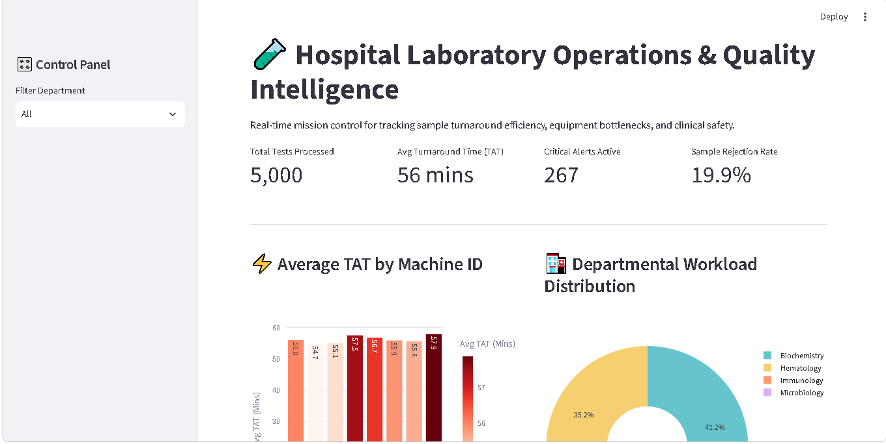
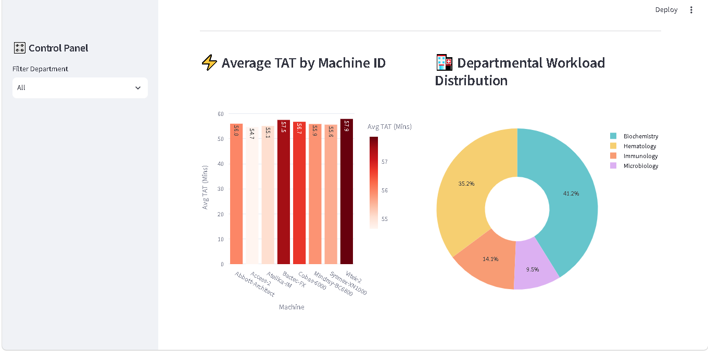
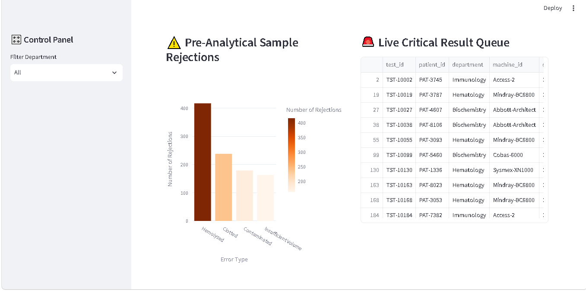

# 🧪 Laboratory Operations & Quality Intelligence Dashboard

A proactive operational intelligence platform designed for Laboratory Managers and Hospital Directors to track real-time lab efficiency, monitor critical diagnostic results, and optimize pre-analytical quality control before clinical bottlenecks compromise patient care.

---

## 📊 Dashboard Preview




> **Live Interactive Demo:** *[Insert Streamlit Cloud Link Here]*

---

## 🎯 The Problem & Business Impact

Hospital laboratories process thousands of biological samples daily, but operational bottlenecks, equipment failures, and pre-analytical errors frequently impede patient care. Traditional reporting relies on siloed spreadsheets, introducing three critical operational vulnerabilities:

1. **Invisible Bottlenecks:** Lack of visibility into which specific diagnostic analyzers, wards, or departments are falling behind schedule.
2. **Missed Critical Results:** High-risk biological findings (e.g., severe sepsis indicators or critical panic values) risk getting buried in standard result queues.
3. **Resource Waste & Re-testing:** High rates of pre-analytical errors (such as sample hemolysis or clotting) waste expensive reagents and require painful re-draws for patients.

---

## 💡 The Solution

This platform transforms passive hospital record-keeping into a real-time operational dashboard. By uniting localized SQLite database queries, automated turnaround time metrics, dynamic quality control tracking, and critical clinical alerting, the system enables laboratory leadership to transition from reactive troubleshooting to continuous quality improvement.

---

## 🚀 Key Features

### 1. Operational Efficiency & Turnaround Time (TAT) Tracking
* Monitors overall and department-specific Average Turnaround Time (TAT) from sample receipt to validation.
* Features comparative bar charts identifying equipment bottlenecks across different diagnostic machines and workstations.
* Highlights active samples that have breached standard operational Service Level Agreements (SLAs).

### 2. Clinical Prioritization & Panic Values
* Dedicated high-priority alert view for critical laboratory results (`critical_flag = True`).
* Ensures urgent diagnostic findings are flagged immediately for rapid physician notification and clinical intervention.

### 3. Quality Control & Pre-Analytical Error Analysis
* Categorizes sample rejections by root-cause failure mode (e.g., *Hemolyzed blood*, *Clotted sample*, *Insufficient volume*, *Contaminated specimen*).
* Tracks error rates by ordering ward to pinpoint where clinical staff require protocol re-education and process improvements.

---

## 🛠️ Technical Architecture & Stack

* **Data Engineering & Simulation:** Python (`pandas`, `numpy`) generating a realistic synthetic dataset mimicking real-world hospital lab workflows (5,000 lab test records).
* **Database Engine:** `SQLite` (`lab_data.db`) providing structured local database querying and record storage.
* **Geospatial & Analytics Interface:** `Streamlit` and `Plotly` providing a fully interactive, responsive web application interface.

```text
lab-operations-dashboard/
│
├── app.py                      # Core Streamlit dashboard application
├── generate_data.py            # Python data generator & SQLite population pipeline
├── requirements.txt            # Python dependencies
├── README.md                   # Technical documentation
│
├── data/
│   └── lab_data.db             # SQLite relational database (Lab records)
│
├── screenshots/
│   ├── dashboard1.png
│   ├── dashboard2.png
│   └── dashboard3.png   # Dashboard UI preview screenshot

⚙️ Installation & Local Setup
To run this dashboard locally on your machine:

Clone the repository:

```bash
git clone https://github.com/PageG80/lab-operations-dashboard.git
cd lab-operations-dashboard
```

Initialize the SQLite Database & Generate Data:

```bash
python generate_data.py
```

Launch the Streamlit Dashboard:

```bash
streamlit run app.py
```